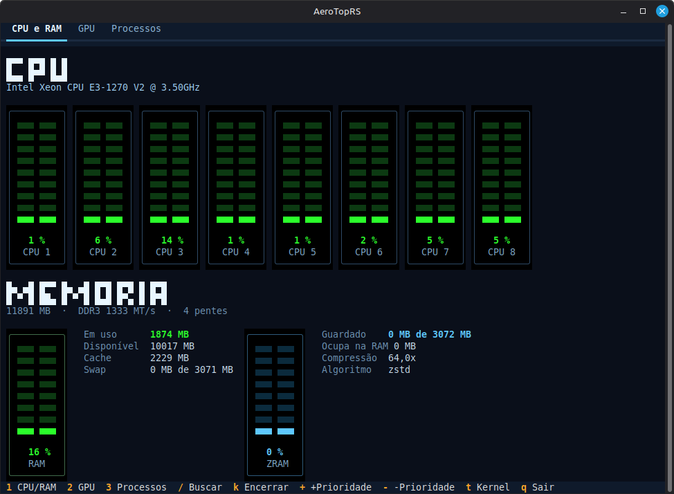
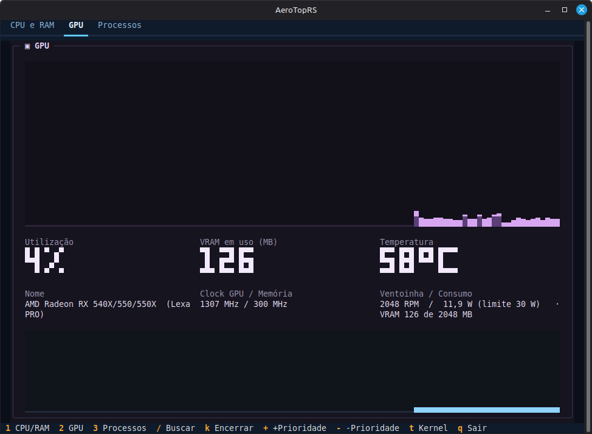
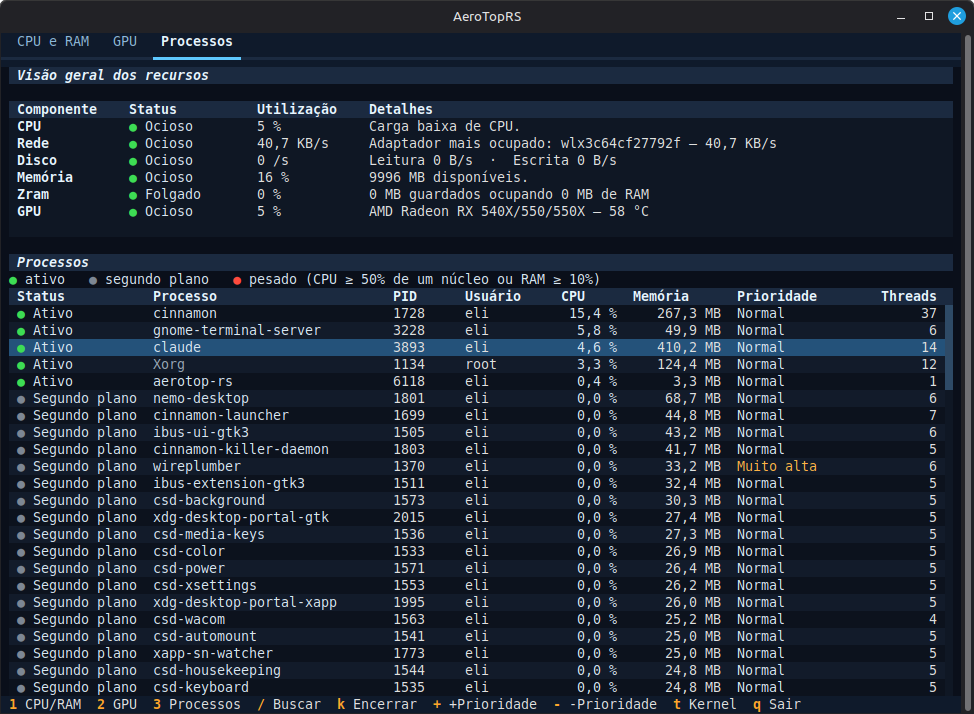

<div align="center">


# 🫧 AeroTop

**Monitor do sistema para o terminal, com visual Frutiger Aero / Windows 7, escrito em Rust.**

CPU, memória, zram, GPU e processos numa tela só, gastando menos de 1,5% de um núcleo.

[**🌐 Página do projeto**](https://1155dosilicon.github.io/aerotop/) · [**⬇️ Baixar**](https://github.com/1155dosilicon/aerotop/releases/latest)



</div>

---

## ✨ O que ele mostra

| Aba | Conteúdo |
|---|---|
| **1 · CPU e RAM** | Um medidor por núcleo no estilo do Windows 7, temperatura da CPU (geral e por núcleo), uso de RAM, cache, swap, tipo e velocidade dos pentes e o zram (quanto guarda, quanto ocupa e a taxa de compressão). |
| **2 · GPU** | Gráfico de uso em tempo real, VRAM, temperatura, clock da GPU e da memória, ventoinha e consumo em watts. Feito para placas **AMD** (driver `amdgpu`). |
| **3 · Processos** | Resumo de CPU, rede, disco, memória, zram e GPU com status (ocioso, folgado, pesado), mais a lista de processos com bolinhas coloridas: 🟢 ativo · ⚪ segundo plano · 🔴 pesado. |

<p align="center">
  
  
</p>

## ⌨️ Teclas

| Tecla | Ação |
|---|---|
| `1` `2` `3` | Troca de aba |
| `/` | Busca um processo pelo nome |
| `↑` `↓` `PgUp` `PgDn` `Home` `End` | Anda pela lista |
| `k` | Encerra o processo selecionado (pede confirmação) |
| `+` / `-` | Aumenta ou diminui a prioridade (pede a senha quando precisa) |
| `t` | Mostra ou esconde as threads do kernel |
| `q` | Sai |

Também dá pra usar o mouse: clique nas abas e use a rodinha na lista.

## ⬇️ Instalação

### Jeito fácil (recomendado)

Um comando instala o programa, o ícone e o atalho no menu (Sistema → AeroTop), tudo dentro da sua pasta pessoal, sem precisar de `sudo`:

```bash
curl -fsSL https://raw.githubusercontent.com/1155dosilicon/aerotop/main/install.sh | sh
```

Se você tiver o Rust instalado, ele compila; se não, baixa o programa pronto. No XFCE, GNOME e MATE o atalho já abre o terminal no tamanho ideal (120×40).

Depois é só abrir pelo menu ou digitar `aerotop` no terminal.

### Pelo código-fonte

Precisa do Rust 1.85 ou mais novo ([rustup.rs](https://rustup.rs)):

```bash
git clone https://github.com/1155dosilicon/aerotop
cd aerotop
./install.sh
```

### Só o programa, sem atalho

Para quem prefere fazer tudo à mão (qualquer Linux de 64 bits x86_64: o programa pronto é estático, não depende da versão da `glibc`):

```bash
wget https://github.com/1155dosilicon/aerotop/releases/latest/download/aerotop
chmod +x aerotop
mkdir -p ~/.local/bin && mv aerotop ~/.local/bin/
aerotop
```

### O que é instalado e onde

| Arquivo | Local |
|---|---|
| Programa | `~/.local/bin/aerotop` |
| Atalho do menu | `~/.local/share/applications/aerotop.desktop` |
| Ícone | `~/.local/share/icons/hicolor/*/apps/aerotop.*` |

> **`aerotop: comando não encontrado`?** A pasta `~/.local/bin` não está no seu PATH. Adicione `export PATH="$HOME/.local/bin:$PATH"` ao final do `~/.bashrc` e abra um terminal novo.
>
> **O atalho não apareceu no menu?** Saia e entre de novo na sessão (no XFCE também dá para rodar `xfce4-panel -r`).

### Desinstalar

```bash
curl -fsSL https://raw.githubusercontent.com/1155dosilicon/aerotop/main/install.sh | sh -s -- --uninstall
```

Ou, de dentro da pasta do código: `./install.sh --uninstall`.

### Extras opcionais

Sem eles o AeroTop abre normal, só perde um detalhe.

| Pacote | Para quê | Ubuntu / Mint | Fedora | Arch | Slackware |
|---|---|---|---|---|---|
| `pciutils` | Nome da placa de vídeo | `sudo apt install pciutils` | `sudo dnf install pciutils` | `sudo pacman -S pciutils` | já vem |
| `dmidecode` | Tipo e velocidade dos pentes de RAM | `sudo apt install dmidecode` | `sudo dnf install dmidecode` | `sudo pacman -S dmidecode` | já vem |
| `polkit` (`pkexec`) | Pedir a senha para mudar prioridade e ler a RAM | já vem | já vem | `sudo pacman -S polkit` | já vem |

Para mostrar os detalhes dos pentes de memória, rode uma vez:

```bash
aerotop --ram
```

Ele pede a senha, lê os dados com o `dmidecode` e guarda em `~/.cache/aerotop/`.

## 📝 Observações

- **GPU:** a aba GPU lê os dados do driver `amdgpu`. Com Nvidia ou Intel o resto funciona, mas essa aba pode ficar vazia.
- **Terminal:** use um terminal com cores de verdade (GNOME Terminal, Konsole, Kitty, Alacritty…). O tamanho ideal é 120×40 ou maior.
- **Leve de verdade:** lê `/proc` e `/sys` direto, sem bibliotecas pesadas, e só redesenha a tela quando algo muda.

## 🛠️ Feito com

[Rust](https://www.rust-lang.org) · [ratatui](https://ratatui.rs) · [crossterm](https://github.com/crossterm-rs/crossterm)

## 📄 Licença

[MIT](LICENSE)
